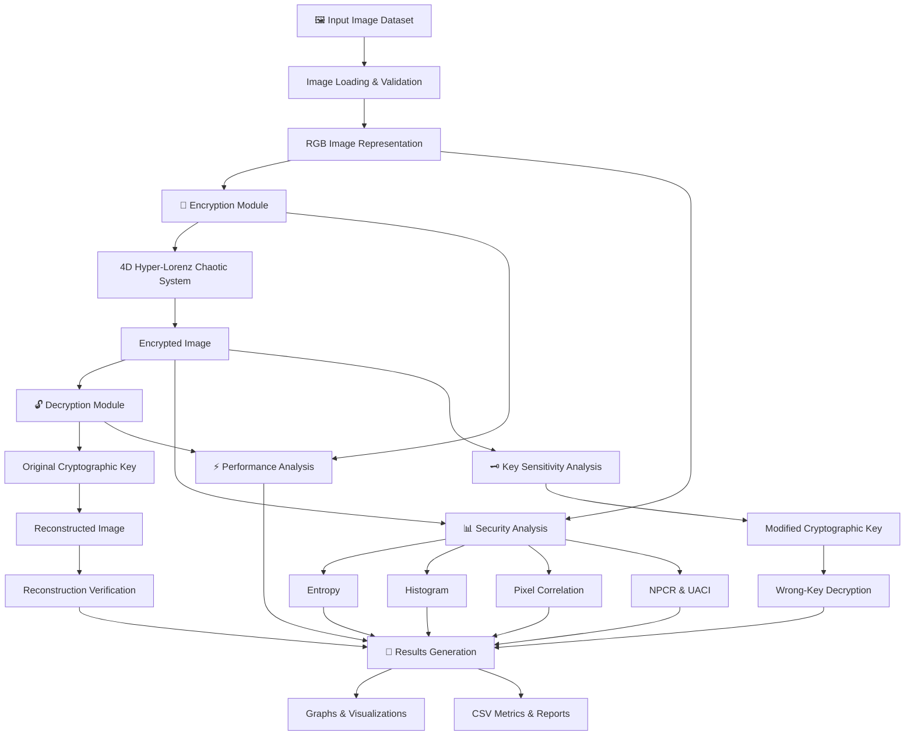
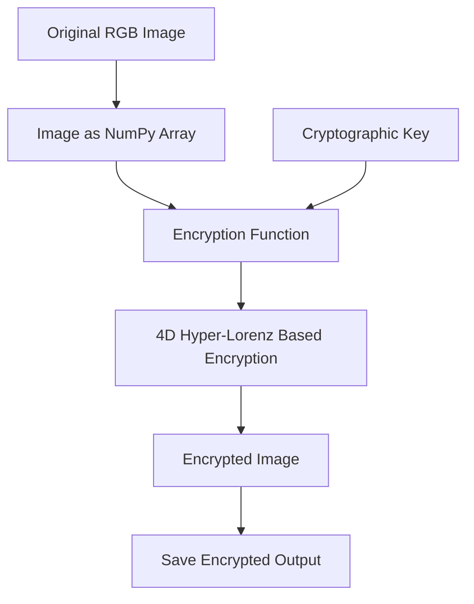
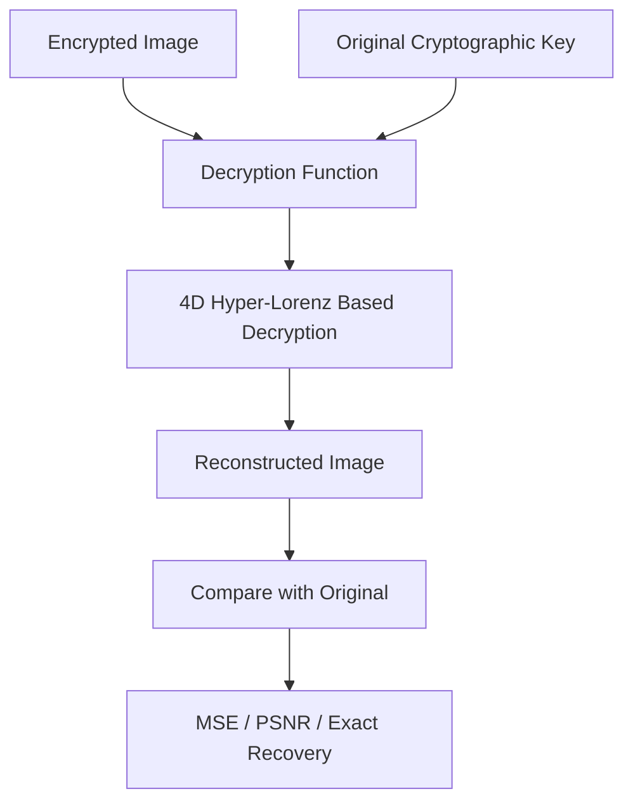

<div align="center">

# 🔐 4D Hyper-Lorenz Based Image Encryption

### Chaos-Based Image Cryptography | Encryption | Decryption | Security Analysis

<p>
  
  
  
  
  
</p>

**Exploring secure image transformation through chaotic dynamical systems.**

</div>

---

# 🌌 About The Project

Images contain considerable spatial redundancy and strong correlations between neighboring pixels. These characteristics make image data susceptible to statistical analysis.

This project explores a **chaos-based image encryption and decryption approach using a 4D Hyper-Lorenz chaotic system**.

The objective is to transform an original image into an encrypted representation with noise-like statistical characteristics and subsequently reconstruct the original image using the correct cryptographic key.

Beyond implementing encryption and decryption, the project incorporates an automated experimental framework to evaluate the algorithm across an entire image dataset.

### ✨ What makes this project interesting?

- 🔐 4D Hyper-Lorenz based chaotic image encryption.
- 🔄 Image reconstruction using the original cryptographic key.
- 🗝️ Key sensitivity analysis using a slightly modified initial condition.
- 📊 Statistical analysis of encrypted images.
- 📈 Pixel correlation analysis across four directions.
- 🧪 Differential analysis using NPCR and UACI.
- ⚡ Encryption and decryption execution-time evaluation.
- 📁 Automated processing and reporting across multiple images.

---

# 🏗️ System Architecture

The project follows a modular pipeline, beginning with image acquisition and ending with consolidated experimental analysis.



---

# 🔐 Encryption Workflow

The encryption stage transforms the original RGB image using the configured cryptographic key.



**Input:** Original image and cryptographic key.

**Processing:** The `Encrypt()` function performs the encryption using the project's 4D Hyper-Lorenz based implementation.

**Output:** Encrypted image.

---

# 🔓 Decryption Workflow

The decryption stage attempts to reconstruct the original image using the same cryptographic key.



The reconstruction is evaluated using:

- Mean Squared Error (MSE)
- Peak Signal-to-Noise Ratio (PSNR)
- Exact pixel-wise recovery

---

# 🖼️ Encryption & Decryption Demonstration

The following visualizations demonstrate the transformation of an original image into its encrypted representation and its subsequent reconstruction.

### Original → Encrypted → Decrypted

<!-- Replace the image path below with an actual comparison image from results/image_comparisons/ -->

<div align="center">


**Figure 1: Original, encrypted and correctly decrypted image.**

</div>

### 🔑 Correct Key vs Modified Key

A small modification is introduced in the initial coordinate of the cryptographic key.

The encrypted image is then decrypted using this modified key to investigate key sensitivity.

<div align="center">


**Figure 2: Decryption using the original and slightly modified cryptographic keys.**

</div>

---

# 🧪 Experimental Analysis

The algorithm is evaluated across multiple images from the dataset.

Each successfully processed RGB image undergoes the same experimental pipeline.

## 📊 1. Histogram Analysis

Histograms compare the pixel intensity distributions of original and encrypted images across the Red, Green and Blue channels.

**Objective:** Examine the statistical distribution of encrypted pixel values.

## 📈 2. Information Entropy

Information entropy measures the uncertainty associated with pixel intensity values.

\[
H(X)=-\sum_{i=0}^{255}p(x_i)\log_2p(x_i)
\]

For an 8-bit channel, the theoretical maximum entropy is 8 bits.

**Objective:** Evaluate the randomness characteristics of encrypted image data.

## 🔗 3. Adjacent Pixel Correlation

Correlation is calculated in four directions:

- Horizontal
- Vertical
- Diagonal
- Anti-diagonal

Pearson's correlation coefficient is used to measure the relationship between neighboring pixels.

**Objective:** Investigate whether encryption reduces spatial correlations.

## 🔄 4. Differential Analysis — NPCR & UACI

A single pixel in the original image is modified, and the resulting encrypted output is compared against the original encrypted image.

**NPCR (Number of Pixel Change Rate)** measures the percentage of pixels that change.

**UACI (Unified Average Changing Intensity)** measures the average intensity difference between corresponding encrypted pixels.

The implementation performs three trials and records their mean values.

## 🗝️ 5. Key Sensitivity Analysis

The initial condition of the cryptographic key is modified:

\[
x_0'=x_0+10^{-10}
\]

The encrypted image is decrypted using the modified key.

The resulting image is compared with the correctly decrypted image.

**Objective:** Investigate the sensitivity of the decryption process to small key variations.

## 🎯 6. Reconstruction Accuracy

Two metrics are used:

**Mean Squared Error (MSE)**

\[
MSE=\frac{1}{N}\sum_{i=1}^{N}(I_i-\hat I_i)^2
\]

**Peak Signal-to-Noise Ratio (PSNR)**

\[
PSNR=10\log_{10}\left(\frac{255^2}{MSE}\right)
\]

Zero MSE indicates exact reconstruction.

## ⚡ 7. Computational Performance

The execution time of encryption and decryption is measured independently for every successfully processed image.

---

# 📸 Results Gallery

The experimental pipeline generates multiple visualizations for every successfully processed image.

| Analysis | Generated Output |
|---|---|
| 🔐 Encryption | Encrypted image |
| 🔓 Decryption | Reconstructed image |
| 🖼️ Image comparison | Original vs encrypted vs decrypted |
| 📊 Histogram | RGB histogram comparisons |
| 📈 Entropy | Channel-wise and overall entropy |
| 🔗 Correlation | Four-direction pixel correlation |
| 🔄 NPCR & UACI | Differential analysis graphs |
| 🗝️ Key sensitivity | Modified-key decryption comparison |
| ⚡ Timing | Encryption and decryption execution time |

### 📂 Consolidated Reports

**`image_metrics.csv`**

Contains individual image measurements, including:

- Image dimensions
- Encryption and decryption time
- RGB and overall entropy
- NPCR and UACI
- MSE and PSNR
- Exact recovery status
- Wrong-key MSE
- Key sensitivity percentage
- RGB channel correlation coefficients

**`summary_statistics.csv`**

Contains aggregate statistical measurements:

- Mean
- Standard deviation
- Minimum
- Maximum

**`processing_errors.txt`**

Records images that could not be processed successfully.

---

# 📁 Repository Structure

```text
IMAGE_ENCRYPTION/
│
├── 📂 dataset/
│   └── miscellaneous/
│       └── misc/
│           └── ... image files
│
├── 📂 results/
│   │
│   ├── 📂 encrypted/
│   ├── 📂 decrypted/
│   ├── 📂 image_comparisons/
│   ├── 📂 histograms/
│   ├── 📂 entropy/
│   ├── 📂 correlation/
│   ├── 📂 npcr_uaci/
│   ├── 📂 key_sensitivity/
│   ├── 📂 timing/
│   │
│   ├── 📄 image_metrics.csv
│   ├── 📄 summary_statistics.csv
│   └── 📄 processing_errors.txt
│
├── 📓 Hyper_lorenz.ipynb
├── 📄 requirements.txt
└── 📄 README.md
```

---

# 🛠️ Tech Stack

| Technology | Application |
|---|---|
| 🐍 Python | Core implementation |
| 🔢 NumPy | Numerical computation and image arrays |
| 🖼️ Pillow | Image loading and processing |
| 📊 Matplotlib | Graphs and visualizations |
| 🐼 Pandas | Experimental data collection |
| 📓 Jupyter Notebook | Interactive experimentation |

---

# 🚀 Getting Started

### 1. Clone the Repository

```bash
git clone https://github.com/ANUP778/IMAGE_ENCRYPTION.git
cd IMAGE_ENCRYPTION
```

### 2. Create a Virtual Environment

```bash
python -m venv venv
```

Activate on Windows:

```bash
venv\Scripts\activate
```

### 3. Install Dependencies

```bash
pip install -r requirements.txt
```

### 4. Launch Jupyter Notebook

```bash
jupyter notebook
```

Open `Hyper_lorenz.ipynb`.

### 5. Run the Experiments

1. Execute the notebook cells in their intended order.
2. Initialize the 4D Hyper-Lorenz encryption and decryption functions.
3. Configure the cryptographic key.
4. Place the extracted dataset inside `dataset/`.
5. Run the complete dataset experimental analysis cell.

The pipeline automatically generates the experimental outputs inside `results/`.

---

# 🔮 Future Scope

Potential directions for further research:

- 🔐 Detailed cryptographic key-space evaluation.
- 🧪 Resistance analysis against additional cryptographic attacks.
- 📊 Comparative evaluation with other chaotic encryption systems.
- ⚡ Computational optimization and parallel processing.
- 🖼️ Testing on larger and more diverse image datasets.
- 🔍 Robustness analysis against noise and image modifications.

---

# ⚠️ Research Disclaimer

This repository presents an experimental implementation of chaos-based image encryption.

The reported metrics evaluate statistical properties, reconstruction accuracy, key sensitivity and computational performance. These metrics alone do not establish resistance to all cryptographic attacks or guarantee real-world cryptographic security.

Further cryptanalysis and security validation are necessary before practical deployment.

---

<div align="center">

### 🌌 Exploring the intersection of Chaos Theory and Image Cryptography.

**4D Hyper-Lorenz Based Image Encryption**

*Research • Experimentation • Analysis*

</div>